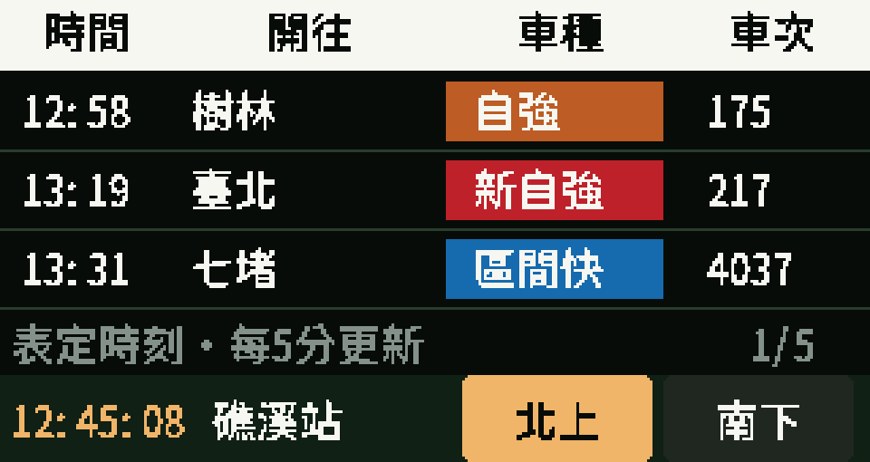

# 臺鐵桌上型時刻看板

**0.2.0 免費時刻表版** · 適用 LILYGO T-Display-S3 Touch 1.9 吋，16 MB Flash／8 MB OPI PSRAM。

橫向 320 × 170 顯示 **時間、開往、車種、車次**，使用臺鐵官方免費 OpenData，每 **5 分鐘**檢查更新。無須 API 金鑰，不會呼叫 TDX 或擷取即時誤點資訊。



## 配網與選站

1. 開機後，手機連接螢幕顯示的 `TRA-xxxxxx` Wi-Fi，密碼也顯示在螢幕上。
2. 開啟 `http://192.168.4.1/`，輸入家中 **2.4 GHz Wi-Fi** 名稱及密碼。
3. 依縣市篩選／搜尋車站，再選擇顯示站點；內建官方 246 站名單。
4. 視需要設定北上／南下或順行／逆行、螢幕方向、自動輪播，按「儲存並重新連線」。
5. 板子會校時、讀取當日檔案目錄，再串流下載官方時刻表，僅保留所選車站的發車資料。

Wi-Fi、車站、方向與螢幕旋轉會記憶在 NVS。修改既有設定時，Wi-Fi 密碼留白表示沿用；換新 Wi-Fi 名稱時需同步輸入新密碼。無密碼 Wi-Fi 請勾選對應選項。

從舊版升級時，沿用既有 Wi-Fi、車站、方向和旋轉設定，更新頻率固定為 300 秒，並清除舊設定物件中的 TDX 金鑰欄位。無須重新申請任何服務。

## 操作

| 操作 | 功能 |
| --- | --- |
| 點底部北上／南下（或順行／逆行） | 切換方向 |
| 點列車區域、頁碼，或短按 GPIO14 | 下一頁，最後一頁再點回第一頁 |
| 點底部站名 | 開啟板上常用車站／全部車站選單 |
| GPIO0／BOOT 按鈕 | 切換方向 |
| 長按 GPIO14 3 秒 | 開啟設定熱點 |
| 設定頁勾選輪播 | 閒置 15 秒後自動切換兩個方向 |

快速切站：點底部站名 → 選常用車站；或點「全部」→ 選縣市 → 選車站。常用清單保留目前與最近選過的六站，初次提供礁溪、宜蘭、羅東、臺北、樹林、花蓮等常見站。選取後自動儲存並重開機載入新站時刻，沿用 Wi-Fi 與螢幕方向，不必重新配網。初次下載需等待網路與官方檔案傳輸。

頁碼 `1/5` 表示列車列表第 1 頁／共 5 頁，每頁三班；第 2 頁是第 4–6 班。總頁數隨目前尚未發車的班次而變動，並不是五種功能畫面。時鐘在左下角，站名與方向控制位於最下列。

連線失敗 30 秒後重新開啟設定熱點；已連家中 Wi-Fi 的設定熱點在 10 分鐘後關閉。

## 螢幕旋轉

配網設定頁的 **螢幕方向** 可選「正常橫向」或「上下顛倒（旋轉 180°）」。儲存並重新開機後套用，畫面與觸控一起旋轉。此設定獨立於「南北方向對調」，後者只交換方向標示。

[看板互動預覽](board-preview.html) 提供兩方向各五頁示範資料，也能旋轉 180°；[設定頁預覽](setup-preview.html) 可查看配網選單。下載後用瀏覽器開啟，預覽不會修改實機。

## 資料與五分鐘更新

- 正式資料來源：[臺鐵鐵路時刻表](https://data.gov.tw/dataset/6138)，官方標示免費、政府資料開放授權條款第 1 版。
- 檔案清單：`https://ods.railway.gov.tw/tra-ods-web/ods/download/dataResource/railway_schedule/JSON/list`。
- 每 300 秒抓取清單，檢查當日檔案的連結與發布資訊。版本相同時使用 RAM 快取；首次開機、檔案異動或跨日後重新下載。不是每五分鐘重複下載整份約 2 MB 的檔案。
- 串流逐車次解析，單一車次 JSON 上限 64 KB，下載上限 8 MB；不建立整份全台時刻表的 JSON DOM。
- 畫面每秒重畫，依表定時間移除已發車班次；切方向與翻頁不額外下載。
- 網路或解析失敗時保留本次開機已取得的時刻表，下個五分鐘週期再試。沒有有效資料時明確顯示等待／下載失敗，不注入示範班次。
- RAM 快取不會在斷電後保留；本版不修改原有檔案系統。重新開機需連網取得資料。
- 官方每日檔反映表定班次；不提供即時誤點、準點、取消或臨時營運狀態。請以站內公告與看板為準。

依官方開發手冊 V1.6，`LineDir` **1 為順行、2 為逆行**，程式正規化為內部 0／1。礁溪等東部幹線預設逆行為北上，西部幹線預設順行為北上，設定頁可交換；支線建議使用順行／逆行。全台南北標示尚未逐站實車確認。

`CarClass` 依官方代碼對照，包含自強 3000、太魯閣、普悠瑪、自強、莒光、區間與區間快。終點站只到站不發車，因此不列入該站發車清單。跨午夜班次會推算正確日期；連續運作跨日時保留尚未發車的舊檔跨夜班次。凌晨冷開機若當日清單已不提供昨日檔，可能缺少昨日始發的跨夜班次。

來源查核：2026-11-11。官方說明：[開發手冊 V1.6](https://ods.railway.gov.tw/tra-ods-web/ods/download/devDoc/8ae4cac27f4c0348017f4dbdd21d0181)。站名來源：[車站基本資料](https://data.gov.tw/dataset/33425)。HTTPS 使用經驗證的 TWCA 根憑證，不略過憑證驗證。

## 建置與測試

```sh
pio run
```

`platformio.ini` 固定 espressif32 6.5.0、Arduino ESP32 2.0.14、TFT_eSPI 2.5.43 與 ArduinoJson 6.21.5；板型和 LCD 設定隨專案提供。

```sh
c++ -std=c++17 -I include -I .pio/libdeps/lilygo/ArduinoJson/src test/test_model.cpp -o /tmp/tra-model-test
/tmp/tra-model-test
c++ -std=c++17 -I include test/test_display_orientation.cpp -o /tmp/tra-orientation-test
/tmp/tra-orientation-test
```

模型測試可加一個官方當日 JSON 檔路徑，驗證完整檔案串流解析。本輪參考檔為 2026-11-11，測出礁溪 92 筆發車資料。

[實際驗證與未測項](docs/verification.md) 分開記錄主機測試、編譯、燒錄和實機驗收。韌體及 SHA-256 見 `firmware/`；[寫入方式](firmware/FLASHING.md) 必須配合相同分割表，不可把固定 offset 套用到其他板型。

序列埠診斷：`?` 回報版本、站點、方向、來源與更新間隔；`b` 切方向；`p` 開設定頁；`s` 輸出 RGB888 畫面。這些回報不含 Wi-Fi 密碼。

## 來源與授權

- 硬體設定：[LILYGO 官方 T-Display-S3](https://github.com/Xinyuan-LilyGO/T-Display-S3)，MIT 授權見 `docs/LILYGO-LICENSE.txt`。
- 字型：Noto Sans TC（OFL），見 `docs/FONT-LICENSE.txt`。已轉成可離線建置的 16 px 點陣，工具為 `tools/generate_assets.py`。
- 官方站名及時刻資料採政府資料開放授權條款第 1 版，顯示時保留來源。
- 本專案未選定整體軟體授權；第三方資料與字型各依其原授權處理。
