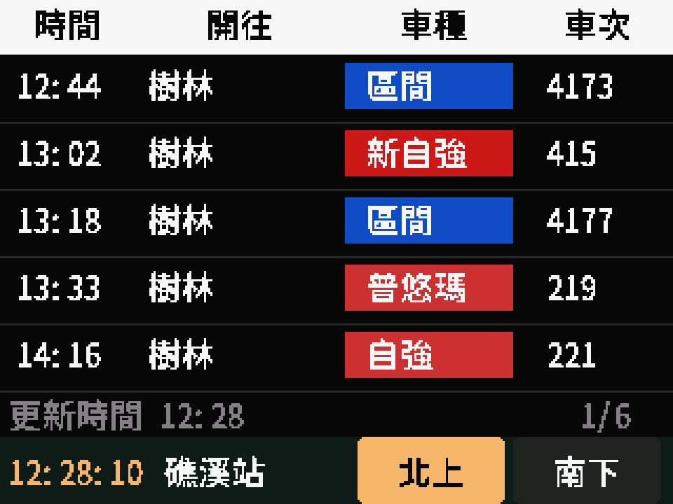
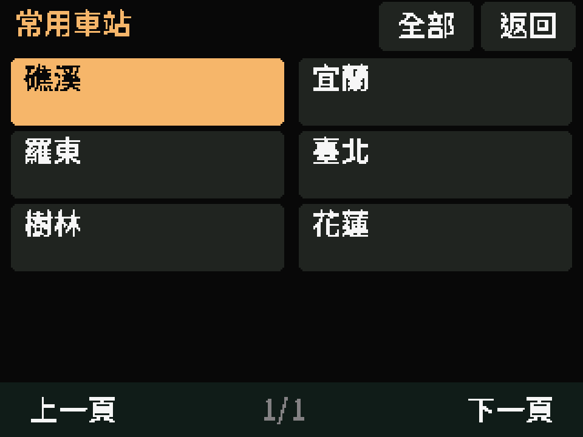

# 臺鐵桌上型時刻看板

橫向顯示 **時間、開往、車種、車次**，支援全台選站、觸控換方向、配網與 180° 螢幕翻轉。使用臺鐵官方 ODS，每 **2 分鐘**檢查更新，無須 API 金鑰；不顯示即時準點或誤點。

目前共用程式與 CYD 預編譯韌體為 **0.3.2**。2.8 吋 CYD2USB 的 0.3.1 及前置版本已完成燒錄、配網、四點校正、五班列車顯示及重啟快取驗證。0.3.2 修正配網頁依板型顯示 BOOT／GPIO14 提示，已完成僅程式區更新、保留設定雜湊核對及重啟連網驗證；實機圖庫擷取自 0.3.1。

## 畫面截圖

**2.8 吋 CYD2USB 北上實機畫面**，原始 320×240，每頁五班；班次為擷取當下內容。



**板上常用車站選單：**



- [2.8 吋分類圖庫：16 張](docs/screenshots-cyd/README.md) — 時刻表、選站、系統示例、四點校正及旋轉示意。
- [1.9 吋分類圖庫：12 張](docs/screenshots/README.md)。
- 圖庫逐張標明實機 framebuffer、實機渲染示例或旋轉示意。配網示例使用假密碼；旋轉圖不代表實體方向已驗收。

## 支援板型

| 板型 | MCU／記憶體 | 顯示與觸控 | 建置環境 | 驗證範圍 |
| --- | --- | --- | --- | --- |
| CYD2USB：ESP32-2432S028 雙 USB 版 | ESP32、4 MB Flash、無 PSRAM | ST7789、XPT2046；320×240、五班 | `cyd-st7789` | 本次實機已驗收核心功能 |
| CYD：ESP32-2432S028R 單 USB 版 | ESP32、4 MB Flash、無 PSRAM | ILI9341、XPT2046；320×240、五班 | `cyd` | 編譯與主機測試；尚未用此版實機驗收 |
| LILYGO T-Display-S3 Touch 1.9 吋 | ESP32-S3、16 MB Flash、8 MB OPI PSRAM | ST7789 並列介面、CST816／CST328；320×170、三班 | `lilygo` | 0.2.1 曾實機驗收；現行共用程式交叉編譯通過 |

請核對完整板號、MCU 與 LCD 批次。僅知道「ESP32／2.8 吋」不足以決定接腳；CYD 的 ESP32 韌體不能用於 ESP32-S3。

CYD2USB 的部分 USB-C 批次有 C-to-C 相容性問題。本次以 **USB-A→Micro-USB 資料線**連線成功，Mac 辨識為 CH340；只有背光亮起不代表已建立資料連線。[CYD2USB 說明](https://github.com/witnessmenow/ESP32-Cheap-Yellow-Display/blob/main/cyd.md)

## 燒錄方式

預編譯套件及每個映像的 SHA-256：

| 目標 | 套件 |
| --- | --- |
| CYD2USB／ST7789，0.3.2 | [firmware/cyd-st7789/](firmware/cyd-st7789/) |
| CYD／ILI9341，0.3.2 | [firmware/cyd/](firmware/cyd/) |
| LILYGO 已實機驗證的舊版 0.2.1 | [firmware/](firmware/manifest.json) 根目錄；現行程式可另行編譯 |

### CYD 首次安裝

接上資料線，確認出現 USB 序列埠。安裝工具後執行：

```sh
python -m pip install esptool==4.5.1 pyserial
python tools/flash_cyd.py --variant cyd-st7789 --baud 115200 --initialize-cache
```

單 USB／ILI9341 版將 `--variant` 改成 `cyd`；多個 USB 裝置時，另加 `--port /dev/cu.usbserial-xxxx` 指定埠。

工具會先比對套件雜湊、ESP32 晶片與 4 MB Flash，預設備份完整原 Flash，再寫入。`--initialize-cache` 會清除快取分割區並建立 LittleFS；備份位於不會提交 Git 的 `.flash-backups/`。明確選擇不備份時可加 `--skip-backup`，晶片及雜湊檢查仍會保留。

自動連線失敗時：**按住 BOOT → 按一下 RESET／RST → 放開 BOOT**；必要時在 Connecting 期間持續按住 BOOT。先使用 115200 baud。[Espressif 下載模式說明](https://docs.espressif.com/projects/esptool/en/latest/esp32/advanced-topics/boot-mode-selection.html)

### 已安裝相同分割表的 CYD 更新

確認 app 位於 `0x10000` 後，可只更新程式，保留 Wi-Fi、觸控校正及快取：

```sh
python -m esptool --chip esp32 --port /dev/cu.usbserial-xxxx --baud 115200 write_flash --flash_mode keep --flash_freq keep --flash_size keep 0x10000 firmware/cyd-st7789/tra-board-app.bin
```

LILYGO 的晶片與分割表不同，請使用 [分板型燒錄說明](firmware/FLASHING.md)。完整 CYD 流程、原生 LittleFS 工具及限制見 [CYD 開發紀錄](docs/cyd.md)。

## 配網、選站與觸控校正

1. 手機連接板上顯示的 `TRA-xxxxxx` 熱點，使用螢幕上的密碼。
2. 開啟 `http://192.168.4.1/`，填入 **2.4 GHz Wi-Fi**，依縣市或站名搜尋選站；內建 246 站。
3. 選擇方向標示、螢幕方向及是否輪播，儲存並重新連線。
4. CYD 首次配網後依序點擊四個十字校正；設定頁亦可勾選「重新校正觸控」。

Wi-Fi、站點、方向、螢幕旋轉與 CYD 校正值保存於 NVS。修改既有設定時，Wi-Fi 密碼留白可沿用；更換 Wi-Fi 名稱時需填入新密碼。

點底部站名 → 選常用站；或點「全部」→ 縣市 → 車站。選站後自動儲存並重開機，沿用 Wi-Fi 與螢幕方向。

| 操作 | CYD 2.8 吋 | LILYGO 1.9 吋 |
| --- | --- | --- |
| 點方向按鈕 | 北上／南下，或順行／逆行 | 同左 |
| 點列車區域／頁碼 | 下一頁，每頁五班 | 下一頁，每頁三班 |
| 按鈕短按翻頁 | BOOT | GPIO14 |
| 按鈕切方向 | 使用觸控方向按鈕 | BOOT |
| 長按 3 秒開配網 | **BOOT** | **GPIO14** |

頁碼 `1/6` 表示列車列表第 1 頁／共 6 頁，總頁數依方向及尚未發車班次變動。時鐘固定左下，站名與方向控制最下方，資訊列顯示「更新時間 HH:MM」。

## 螢幕上下顛倒 180°

**已支援，觸控座標同步轉換，設定會在重開機後保留。**

1. CYD 長按 **BOOT 3 秒**；LILYGO 長按 **GPIO14 3 秒**，開啟設定熱點。
2. 手機進入配網頁，在「螢幕方向」選擇 **上下顛倒（旋轉 180°）**。
3. 儲存並重新開機套用。既有 Wi-Fi 密碼可留白沿用，站點可保持原設定。

螢幕旋轉與「南北方向對調」是不同選項。CYD 使用已保存的校正值，再依方向轉換座標；如需重做校正，可在同一頁勾選重新校正。座標測試已通過，實體 180° 方向及觸控驗收仍另行記錄。

## 資料與快取

- [臺鐵官方 ODS 時刻表](https://data.gov.tw/dataset/6138)，不需要 TDX Client ID／Secret。
- 每 120 秒檢查當日檔案清單；首次、檔案異動或跨日才下載完整資料。兩分鐘是檢查頻率，來源仍是官方表定時刻。
- CYD 每次解析單站 JSON 並保存精簡停站資料；畫面使用 15 KiB 小區塊緩衝，不依賴 PSRAM。
- CYD 成功下載後保存 LittleFS 快取，包含 CRC、車站與日期檢查；錯誤／截斷檔不替換既有資料。離線冷開機未校時時顯示快取日期，時鐘保持 `--:--:--`。
- LILYGO 保留原有檔案系統，只使用 RAM 時刻表快取，重新開機需連網下載。
- 下載失敗時保留快取，下一個兩分鐘週期再試；沒有有效資料時顯示等待或失敗，不填入示範班次。
- 方向、終點站與跨午夜邏輯共用；全台各站南北標示尚未逐站實車確認。凌晨冷開機缺少昨日來源檔時，可能缺少昨日始發的跨夜班次。

## 自行編譯與驗證

```sh
pio run -e cyd-st7789
pio run -e cyd
pio run -e lilygo
```

PlatformIO 設定固定 espressif32 6.5.0、Arduino ESP32 2.0.14、TFT_eSPI 2.5.43、ArduinoJson 6.21.5。CYD 使用 4 MB 單一 app 分割表，採 USB 更新；目前不提供 OTA。

[驗證紀錄](docs/verification.md) 區分主機測試、交叉編譯及實機驗收；[CYD 紀錄](docs/cyd.md) 包含 95 筆正式班次、重啟快取、兩分鐘檢查與實機截圖證據。長時間、實際跨日及 180° 實體觸控測試仍待驗證。

[2.8 吋互動預覽](cyd-preview/board-preview.html)／[2.8 吋配網頁預覽](cyd-preview/setup-preview.html)／[1.9 吋互動預覽](board-preview.html)／[1.9 吋配網頁預覽](setup-preview.html)。下載後用瀏覽器開啟；互動預覽使用示範資料，不會改動實機。

## 來源與授權

- LILYGO 硬體設定：[官方 T-Display-S3](https://github.com/Xinyuan-LilyGO/T-Display-S3)，MIT 授權見 [LILYGO-LICENSE](docs/LILYGO-LICENSE.txt)。
- CYD：[社群板型與雙 USB 設定](https://github.com/witnessmenow/ESP32-Cheap-Yellow-Display)、[PlatformIO 板型定義](https://github.com/rzeldent/platformio-espressif32-sunton)。
- Noto Sans TC 字型使用 OFL，見 [FONT-LICENSE](docs/FONT-LICENSE.txt)。
- 官方資料採政府資料開放授權條款第 1 版。本專案未選定整體軟體授權，第三方資料與字型各依其原授權。
