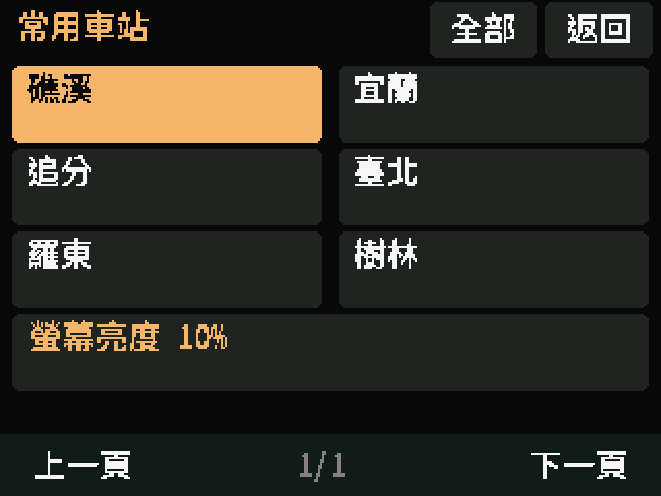
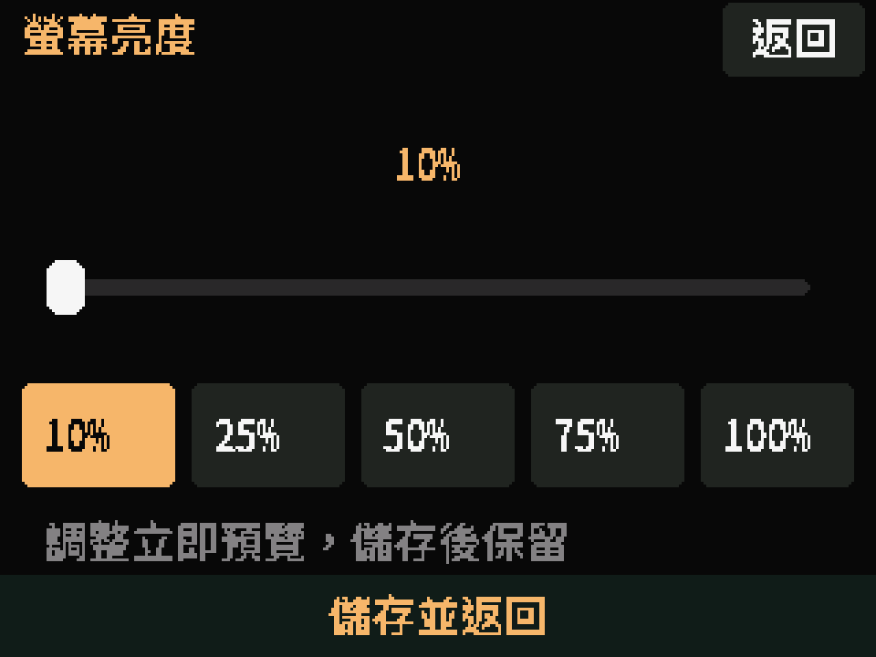

# 0.3.3 螢幕亮度實機畫面

以下為 2026-11-13 19:54（Asia/Taipei）重新從 ESP32-2432S028 CYD2USB 執行 0.3.3 擷取的最新畫面，使用目前已儲存的 10% 亮度。原始 320×240，以最近鄰放大至 960×720；每張 240 列均由 CRC32／ACK 檢查完整性，細節見 [最新擷取紀錄](latest/manifest.json)。

## 常用車站亮度入口

六個常用站下方新增「螢幕亮度」按鈕，不會切換車站或重啟。

## 亮度設定頁

可點滑桿或 10／25／50／75／100% 快選，立即預覽；底部「儲存並返回」保存至 NVS，右上「返回」取消。

擷取時使用診斷切頁，只渲染既有亮度，沒有寫入設定。兩張共 480 列 CRC 驗證成功、零重傳；擷取後確認礁溪站、北上、原頁碼、180°、觸控校正及 10% 亮度皆保留，已退出診斷模式，Wi-Fi 仍連線。Framebuffers 採邏輯正向呈現，PNG 像素不代表實體背光的明暗。

使用者已確認觸控調整會改變實體亮度；最後自行設定 10%，硬體重啟後讀回仍為 10%／PWM 26，完成保存驗收，詳見 [驗證紀錄](../verification.md)。

## 先前的 100% 畫面

保留先前擷取的 [常用車站](01-recent-stations-brightness.png)、[亮度頁](02-brightness-controls.png) 與 [原擷取紀錄](manifest.json)，作為同版韌體初次驗證的歷史資料；README 目前引用上方最新的 10% 畫面。
