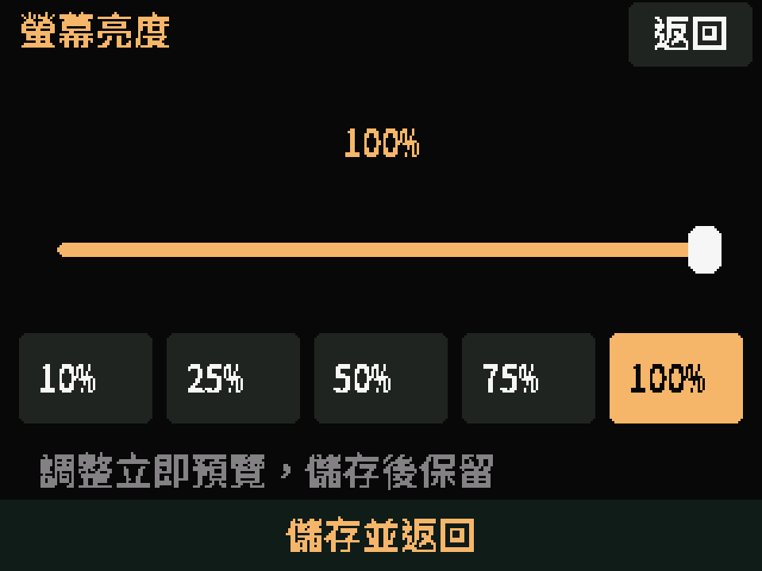

# 0.3.3 螢幕亮度實機畫面

以下為 ESP32-2432S028 CYD2USB 執行 0.3.3 的 framebuffer 擷取，原始 320×240，以最近鄰放大至 960×720。每張 240 列均由 CRC32／ACK 檢查完整性，細節見 [manifest.json](manifest.json)。

## 常用車站亮度入口

六個常用站下方新增「螢幕亮度」按鈕，不會切換車站或重啟。

## 亮度設定頁

可點滑桿或 10／25／50／75／100% 快選，立即預覽；底部「儲存並返回」保存至 NVS，右上「返回」取消。

擷取時使用診斷切頁，只渲染既有亮度（100%），未模擬使用者觸控或寫入設定。擷取後確認原站點、方向、180°、校正、亮度與頁碼均恢復；此圖本身不代表實體觸控調整及保存驗收。裝置原設定為 180°，framebuffer 圖採邏輯正向呈現。

後續已由使用者確認觸控調整會改變實體亮度；最後自行設定 10%，硬體重啟後讀回仍為 10%／PWM 26，完成保存驗收。原圖仍保留擷取當下的 100%，詳見 [驗證紀錄](../verification.md)。
