# CYD 2.8 吋分類畫面

原始 320×240，PNG 放大為 960×720。時刻表為擷取當下資料，非現在班次。
一般頁面以 USB 診斷切頁後讀取實機 framebuffer，每列經 CRC32 驗證。配網／切換／校正提示是實機渲染示例；旋轉圖另標示為示意。未上傳真實 Wi-Fi 密碼，擷取後已恢復原站點與畫面狀態。

## 時刻表

### 01 礁溪站・北上

實機 framebuffer；USB 診斷切頁

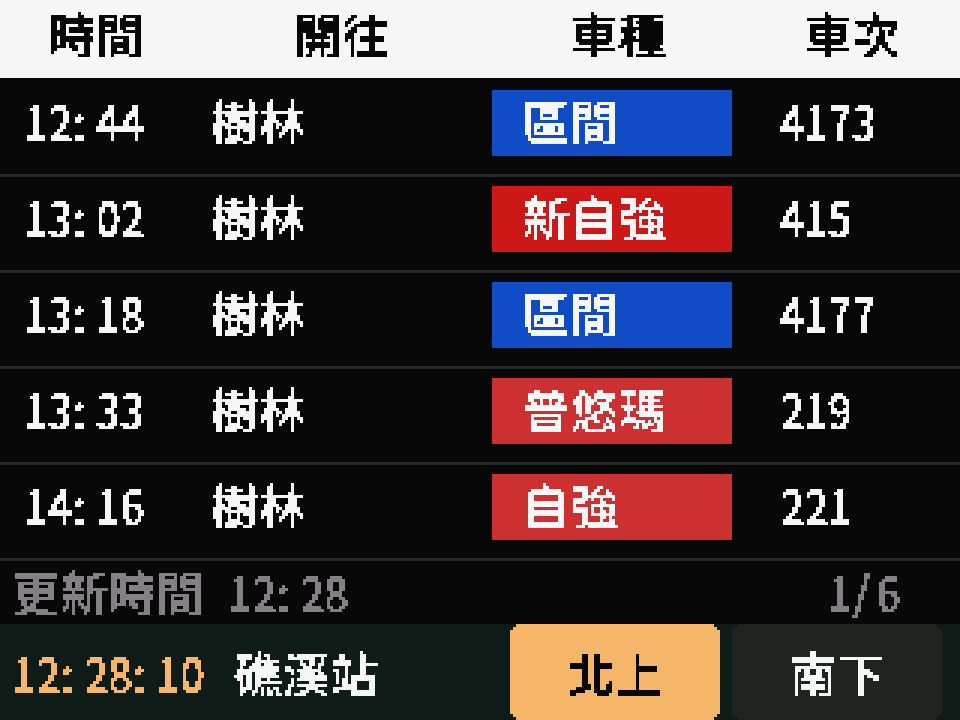

### 02 礁溪站・南下

實機 framebuffer；USB 診斷切頁

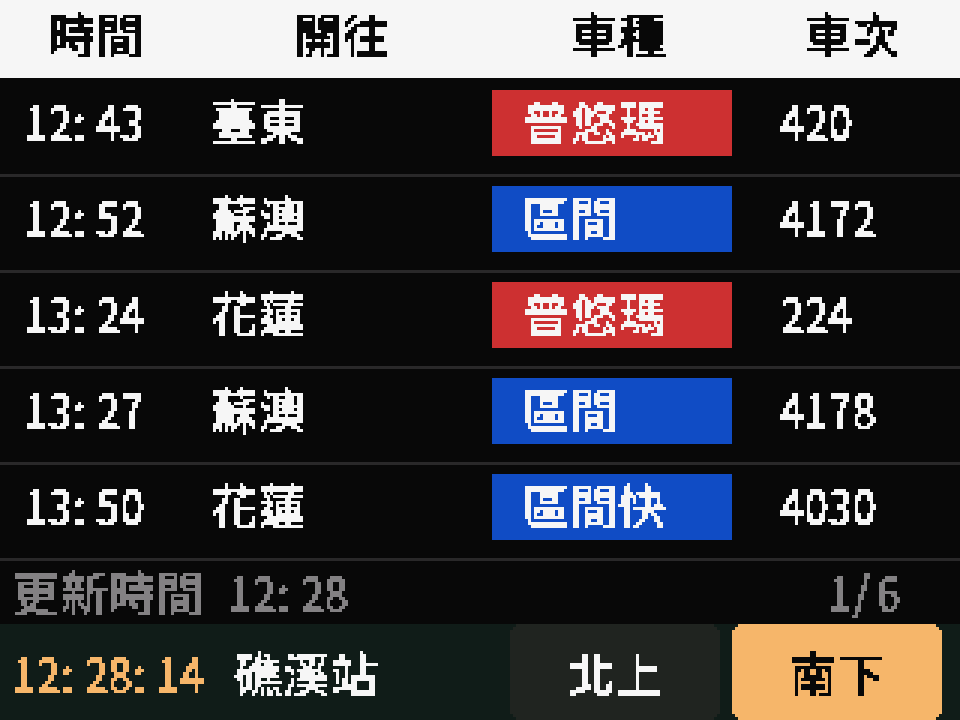

## 選站介面

### 03 常用車站

實機 framebuffer；USB 診斷切頁

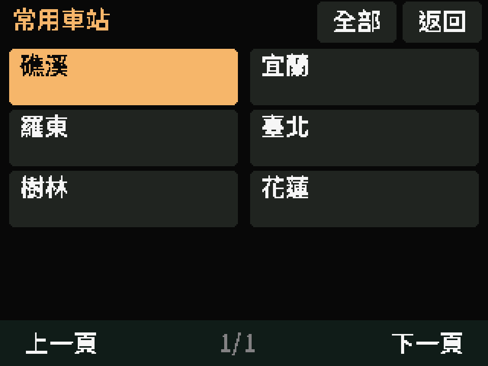

### 04 縣市清單 1/3

實機 framebuffer；USB 診斷切頁

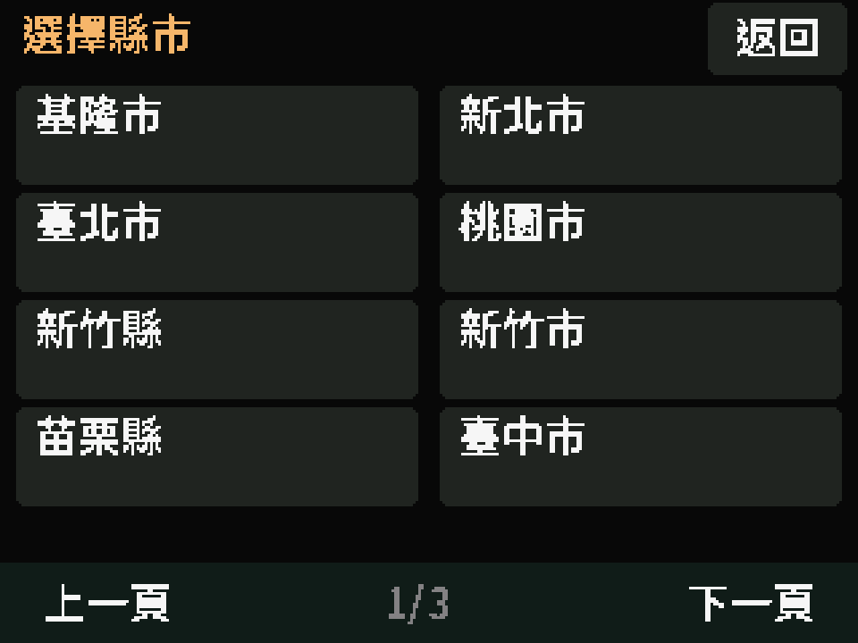

### 05 縣市清單 2/3

實機 framebuffer；USB 診斷切頁

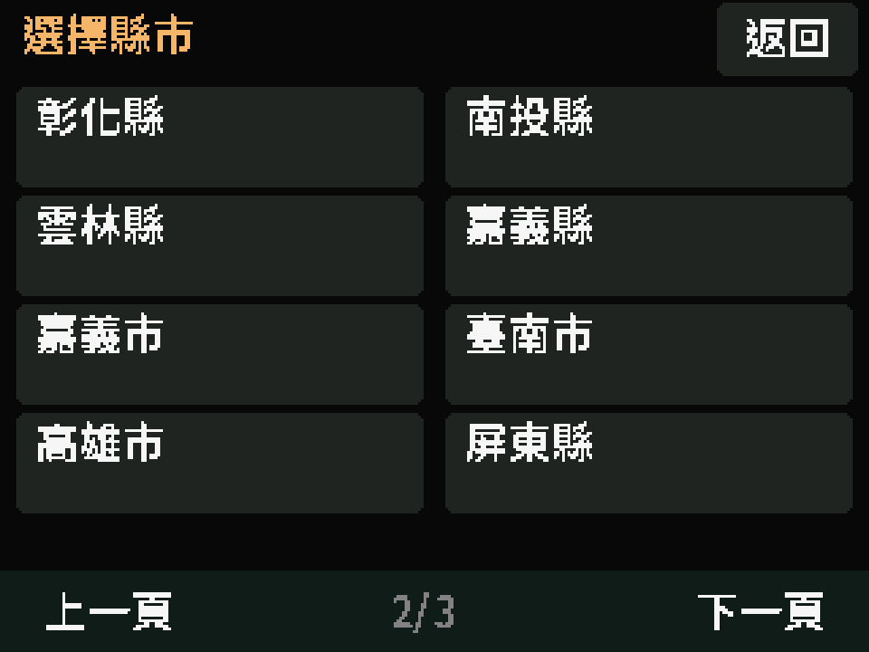

### 06 縣市清單 3/3

實機 framebuffer；USB 診斷切頁

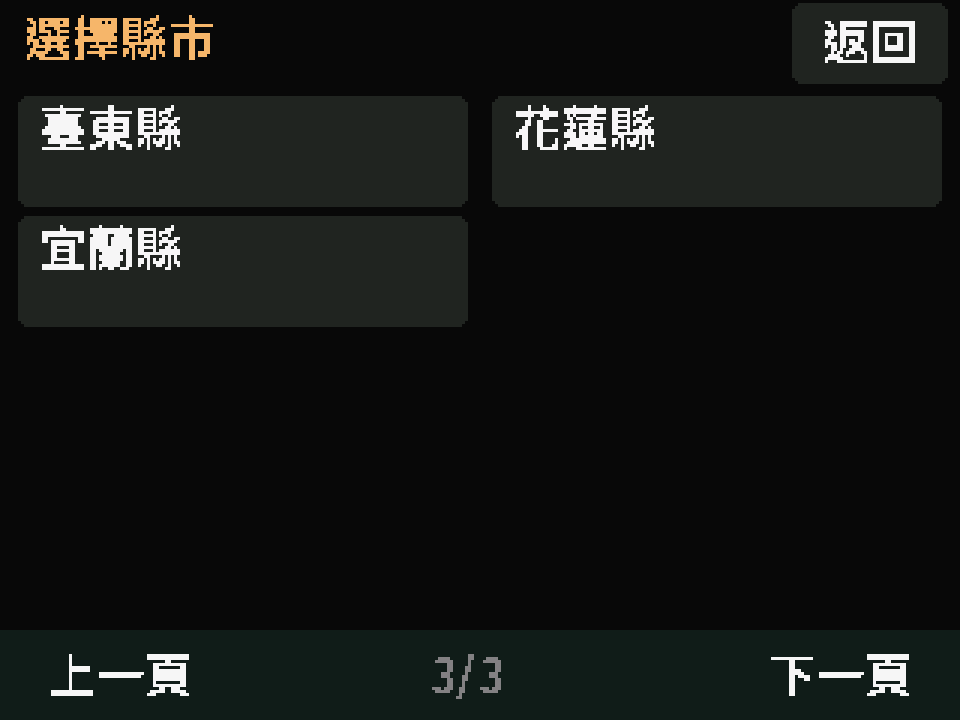

### 07 宜蘭縣車站 1/3

實機 framebuffer；USB 診斷切頁

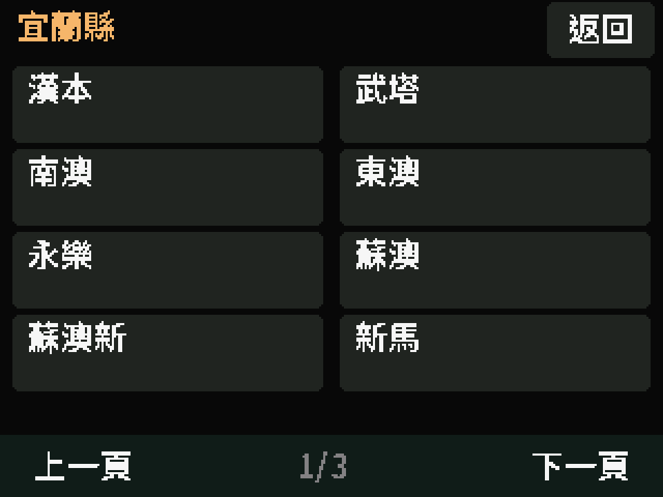

### 08 宜蘭縣車站 2/3

實機 framebuffer；USB 診斷切頁

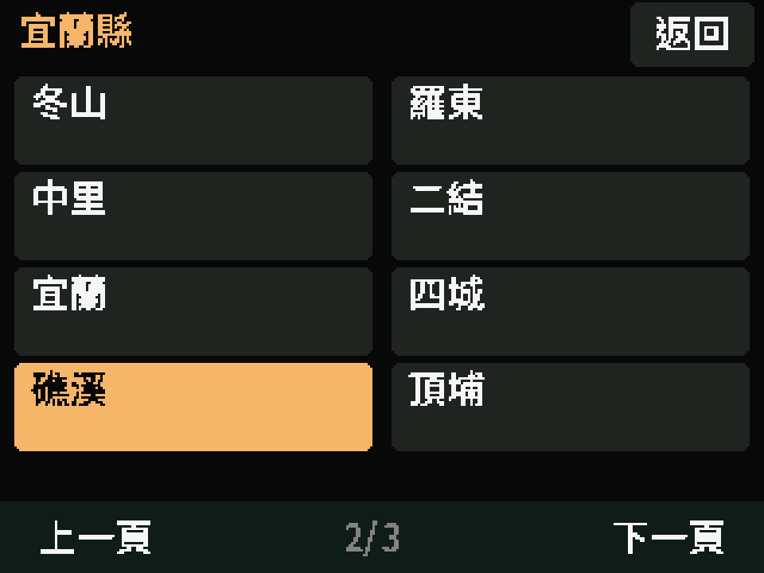

### 09 宜蘭縣車站 3/3

實機 framebuffer；USB 診斷切頁

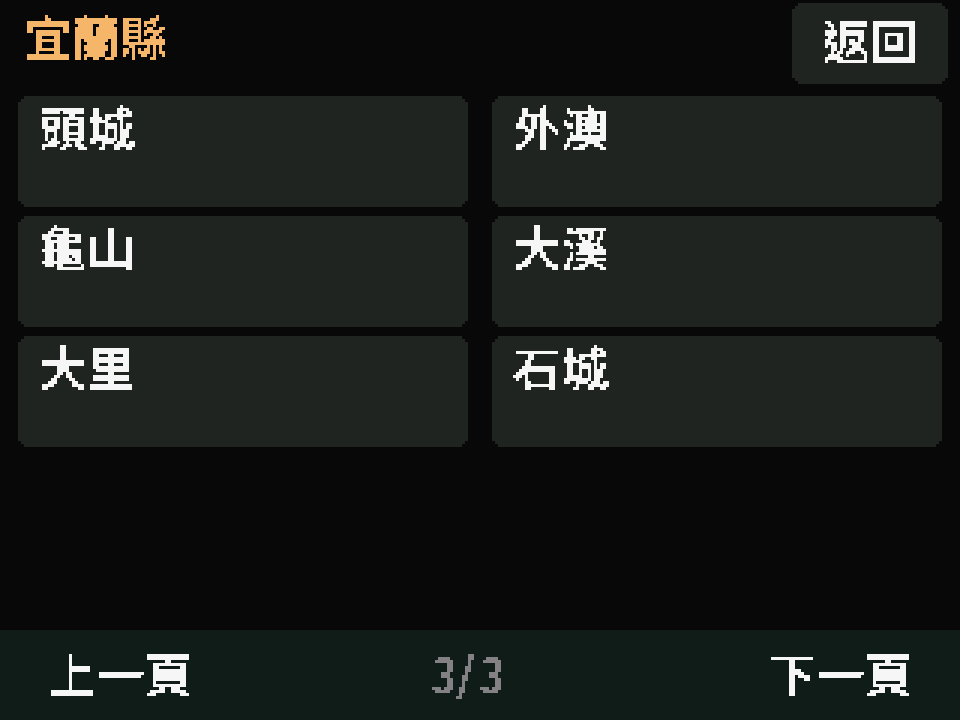

## 系統提示

### 10 切換車站提示

實機渲染示例；沒有儲存選站或重啟

### 11 板上配網提示

實機渲染示例；TRA-DEMO／DEMO1234 為假資料，未開啟熱點

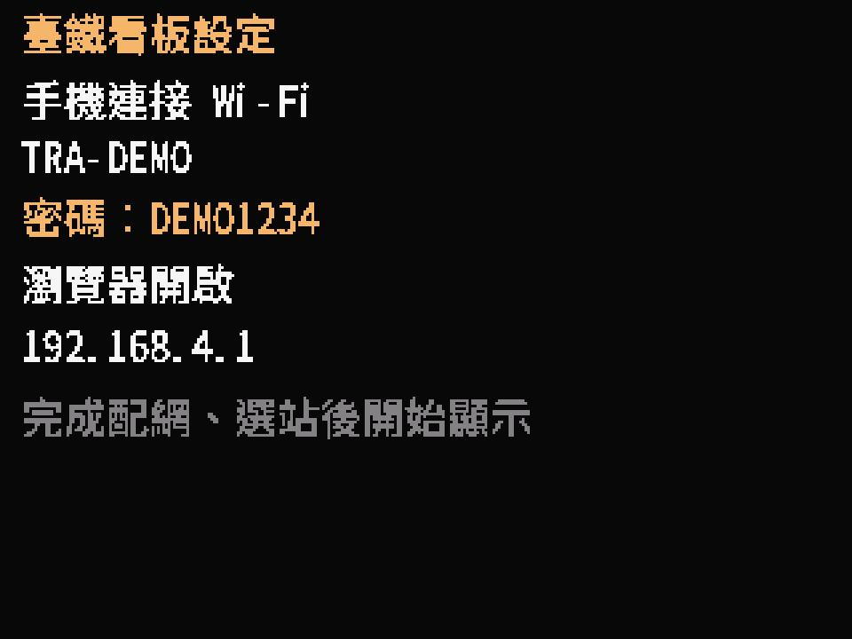

## 觸控校正

### 12 觸控校正 1/4

實機渲染校正提示；不改寫既有校正值

### 13 觸控校正 2/4

實機渲染校正提示；不改寫既有校正值

### 14 觸控校正 3/4

實機渲染校正提示；不改寫既有校正值

### 15 觸控校正 4/4

實機渲染校正提示；不改寫既有校正值

## 旋轉示意

### 16 上下顛倒方向示意

由第一張實機 framebuffer 旋轉示意；非實體方向／觸控驗收

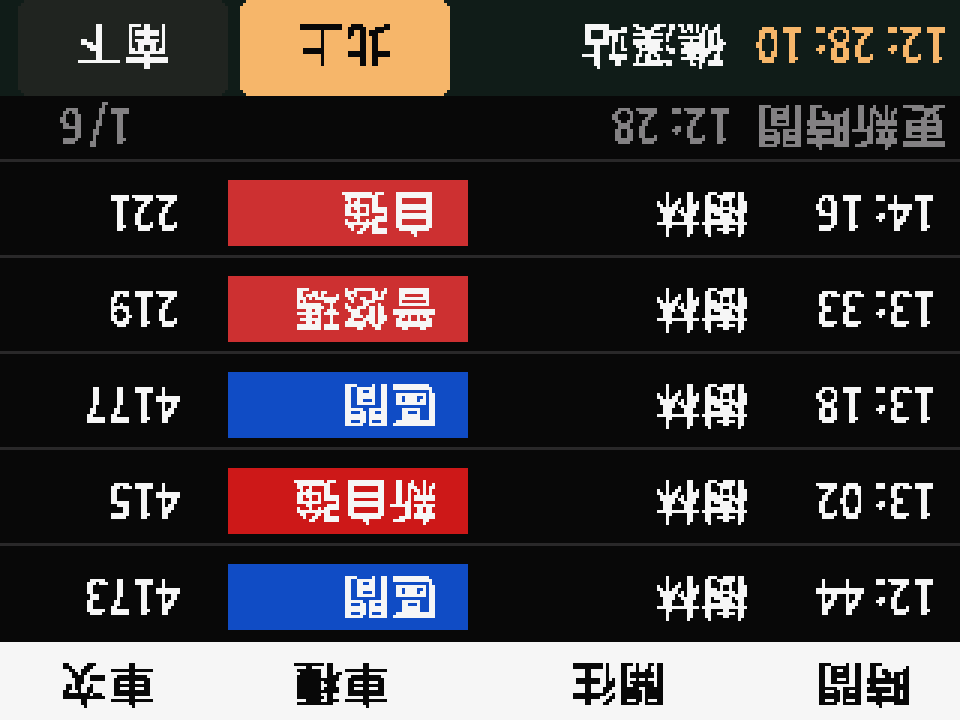
