# 0.2.1 畫面截圖

日期：2026-11-12（Asia/Taipei）。共 12 張獨立 PNG，皆為 960 × 510（原始 320 × 170 放大三倍）。

01、02 為實機 framebuffer；03–11 為程式模擬；12 為實機畫面的旋轉示意。截圖中的時刻是擷取當下內容，不代表目前班次。

## 實機畫面

USB 讀取實機 framebuffer，非相機拍攝。

### 01 順行時刻表

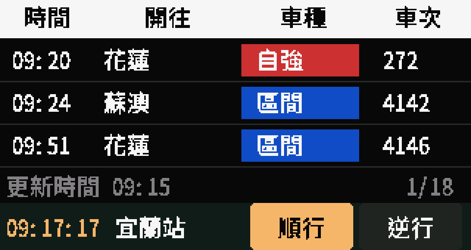

### 02 逆行時刻表

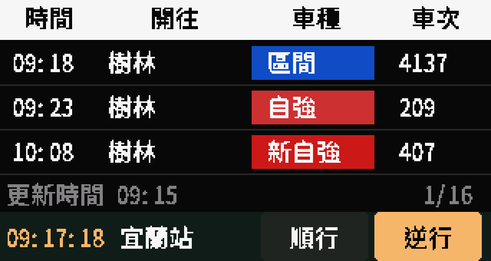

## 選站介面

依 0.2.1 程式與官方站名資料模擬；常用車站順序為示例。

### 03 常用車站

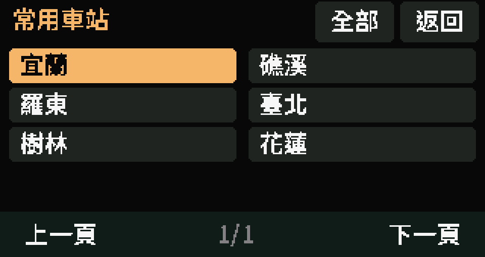

### 04 縣市清單 1/3

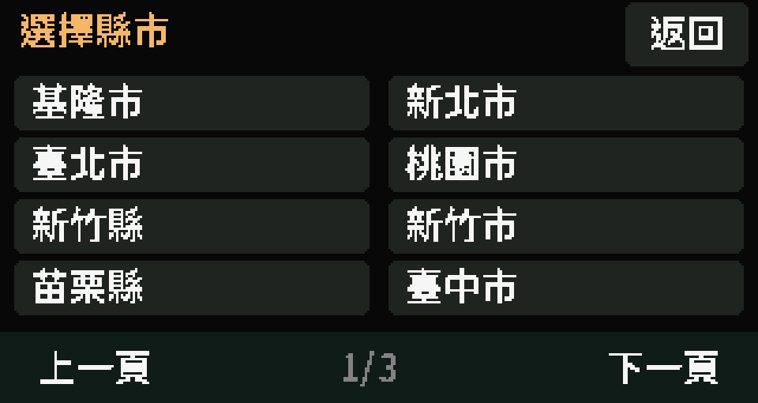

### 05 縣市清單 2/3

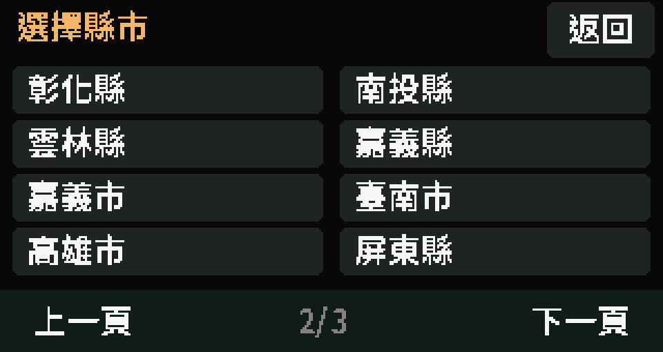

### 06 縣市清單 3/3

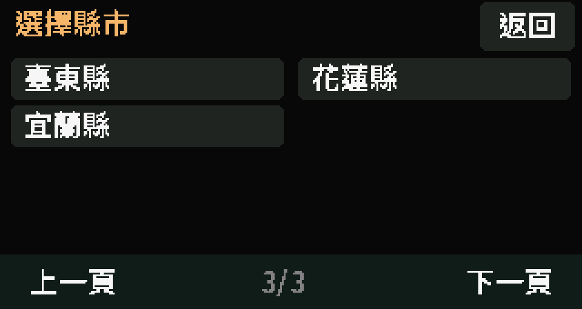

### 07 宜蘭縣車站 1/3

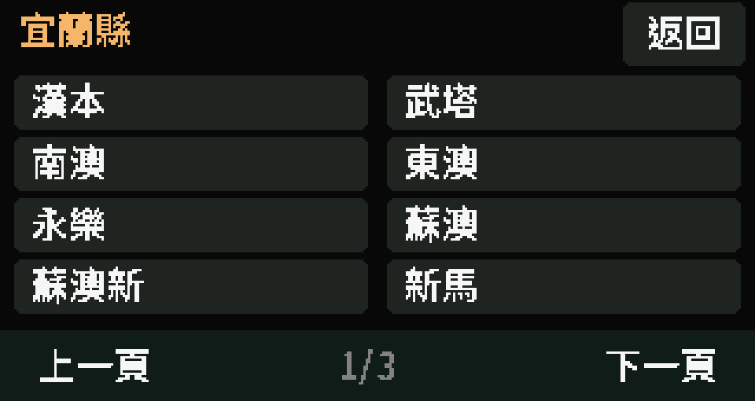

### 08 宜蘭縣車站 2/3

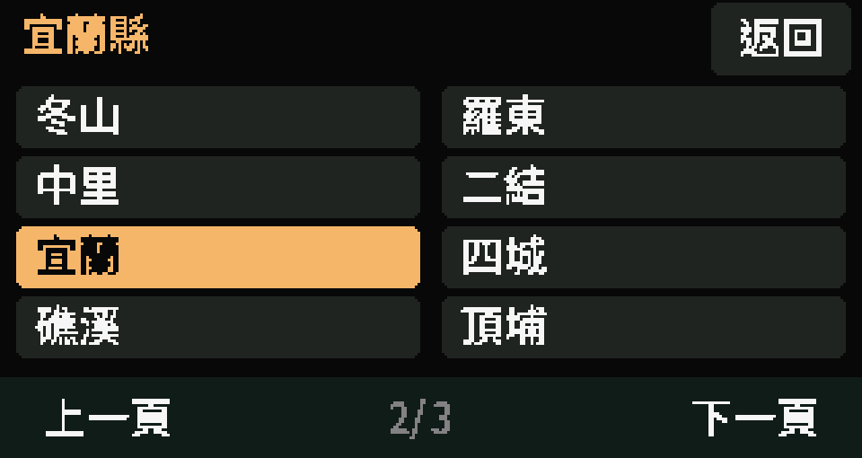

### 09 宜蘭縣車站 3/3

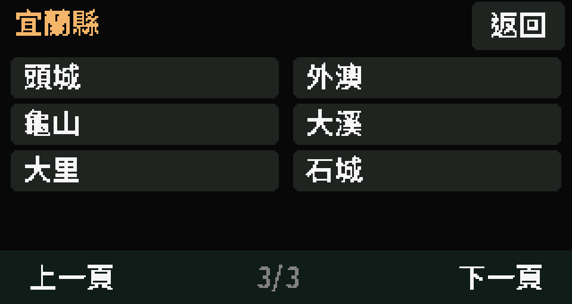

## 系統提示

依 0.2.1 程式模擬。配網圖中的 TRA-DEMO、DEMO1234 均為示例，非真實熱點或密碼。

### 10 切換車站提示

### 11 板上配網提示

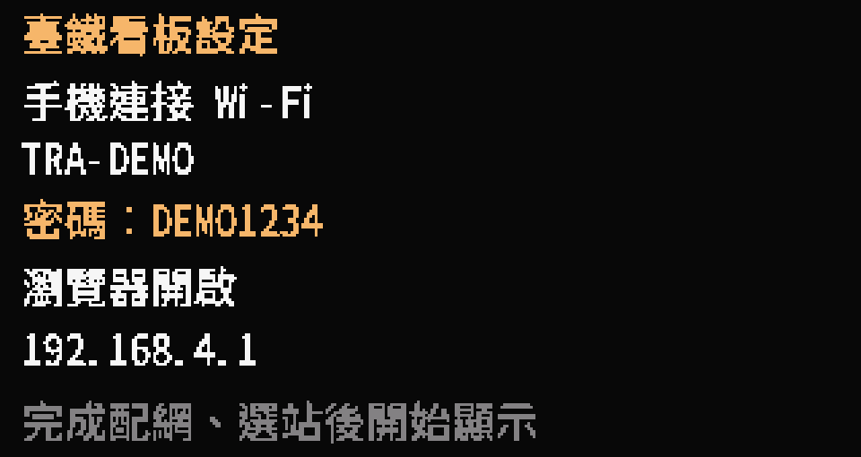

## 旋轉示意

將實機 framebuffer 旋轉 180°，僅示意畫面方向；不代表實體 LCD 方向或觸控已驗證。

### 12 上下顛倒示意

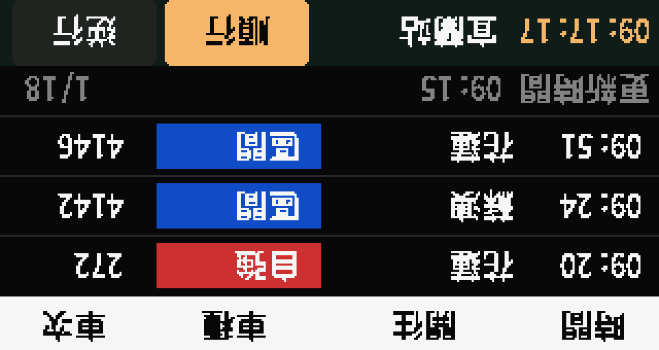
